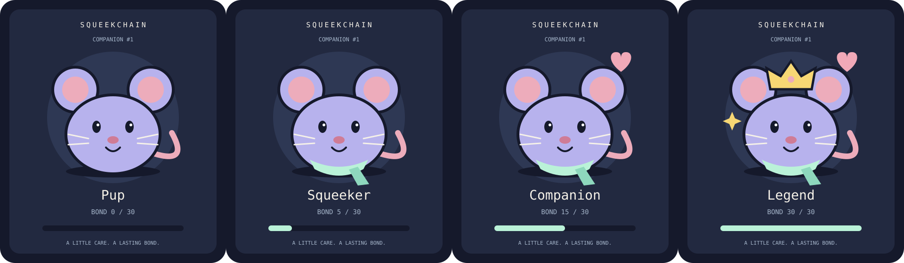

# Squeek Companion

A dynamic ERC-721 collection for Squeekchain on **Ethereum Sepolia (chain ID 11155111)**. Name: **Squeek Companion**. Symbol: **SQCOMP**. Exactly **999** tokens, numbered **1–999**, exist from deployment onward.

## Design and assumptions

The brief specifies the identity, supply, network, and dynamic behavior, but no sale, allocation schedule, game rules, art assets, or metadata service. This implementation makes the following choices:

- All 999 tokens are created in the constructor and assigned to the supplied launch owner. Distribution is through ordinary ERC-721 transfers. There is no public mint, additional issuance, or burn function.
- The current holder calls `pet(tokenId)` to increase bond by one. The first pet is available immediately; later pets require a rolling **24 hours**. Missed days do not accumulate pets or reduce progress.
- Bond stops at **30**. Petting changes the JSON attributes, progress bar, and, at stage boundaries, the mouse's accessories. Reaching Legend takes 30 transactions across at least 29 days. No background job or real-time waiting is needed to deploy or test the collection.
- Progress and cooldown belong to the token and survive transfers. Approved marketplace operators can transfer tokens but cannot pet them while someone else owns them.
- Artwork and JSON are generated entirely on-chain. Six deterministic color palettes cycle by token ID: `(tokenId - 1) % 6 + 1`. This is cosmetic variation, not randomness or a rarity promise.
- There is no sale price, payment collection, royalty, oracle, external renderer, backend signer, administrative role, pause, or upgrade mechanism. Holders pay network gas for transactions.

| Bond | Stage | Artwork change |
| --- | --- | --- |
| 0–4 | Pup | Mouse with the token's permanent palette |
| 5–14 | Squeeker | Adds a scarf |
| 15–29 | Companion | Adds a heart |
| 30 | Legend | Adds a crown and sparkle |



This preview is generated from token #1's local `tokenURI` output at bonds 0, 5, 15 and 30.

Constants are in [SqueekCompanion.sol](src/SqueekCompanion.sol) (`MAX_SUPPLY = 999`, `MAX_BOND = 30`, `PET_COOLDOWN = 1 days`) and [SqueekArt.sol](src/SqueekArt.sol) (stage thresholds 5/15/30 and six palettes). These choices are immutable after deployment.

## Build and test

Run from the repository root with Foundry and Solidity **0.8.26** available:

```sh
forge build
FOUNDRY_FUZZ_SEED=0x236797faf6acfed737a13774e3160ca8a22b4ee390c285dbe0414d36976fc26b forge test
forge fmt --check
```

The compiler is pinned in `foundry.toml`, with Cancun EVM output, optimizer enabled at 200 runs, and `bytecode_hash = "none"`. The compiler is provided by the verification environment. All Solidity dependencies are ordinary files in `lib/`; no network, package installation, submodule, FFI, filesystem cheatcode permission, or environment variable read is needed by the contracts or tests. The shell's fuzz seed configures Foundry, not the test code.

OpenZeppelin Contracts **v5.2.0** supplies ERC-721/2309 and encoding utilities; forge-std **v1.9.6** supplies test tools. Only the required OpenZeppelin source closure and forge-std source are vendored, unchanged, with their licenses. Archive provenance and individual file hashes are in [docs/dependencies.txt](docs/dependencies.txt) and [docs/dependencies.sha256](docs/dependencies.sha256). Optionally verify them with `sha256sum --check docs/dependencies.sha256`.

Tests cover fixed supply and every initial token owner; CREATE2 factory deployment; interface IDs; approvals and revoked/stale authority; safe-transfer rejection and callback reentrancy; non-existent IDs; first pet, cooldown edges, stage boundaries and final cap; persistence across transfers; decoded JSON/SVG metadata; metadata update events; and stateful model checks for balances, ownership, and progress. The stateful test also counts every token after each generated sequence. Tests use local deployments and simulated time, never a live RPC or wallet.

## Deployment parameters

Deploy **one application**, `src/SqueekCompanion.sol:SqueekCompanion`.

| Parameter | Value |
| --- | --- |
| Network | Ethereum Sepolia, chain ID `11155111` |
| Constructor | `constructor(address initialOwner)` |
| `initialOwner` | `$owner`, resolving to `0x3C7838665Ff8215c95500E1a6306e19E146674a0` |
| Deployment value | `0` ETH; constructor is nonpayable |
| Initial allocation | IDs `1` through `999`, all to `initialOwner` |
| Initialization calls | None |
| External contract dependencies | None |
| Library linking | None; renderer/library functions are internal |

`initialOwner` must be nonzero. The constructor does not infer an owner from `msg.sender` or `tx.origin` and does not call the recipient or any external contract. A factory therefore receives no tokens or privileges. There is no collection-level `owner()` role; “owner” in the constructor means the initial NFT holder. The supplied recipient must be a controlled wallet capable of managing ERC-721s; constructor allocation deliberately does not call `onERC721Received`.

The launch service supplies deployment and the separate manifest after acceptance. This repository does not broadcast transactions or contain `launch.json`, wallet keys, or an invented deployment address. `SqueekArt` is an internal library, not a second application. The contract does not enforce a chain-ID check; the deployer must use the specified network.

## After launch

No settings or setters are required. The application is fully configured by construction.

1. The deployment operator confirms chain ID, published address, bytecode, name, symbol, supply, recipient balance, and the initial allocation event; verifies the source with the pinned compiler settings; and hands the confirmed address to users and indexers.
2. The initial holder distributes tokens using `safeTransferFrom(initialOwner, recipient, tokenId)`, or the standard overload with receiver data. Recipients that are contracts must accept ERC-721 safe transfers. No distribution agent or recipient list is embedded in this project.
3. Indexers process the constructor's `ConsecutiveTransfer(1, 999, address(0), initialOwner)` and subsequent ordinary `Transfer` events. The initial allocation uses [ERC-2309](https://eips.ethereum.org/EIPS/eip-2309), as implemented by [OpenZeppelin ERC721Consecutive](https://github.com/OpenZeppelin/openzeppelin-contracts/blob/v5.2.0/contracts/token/ERC721/extensions/ERC721Consecutive.sol), to avoid a 999-iteration mint. An indexer that only watches `Transfer` events will miss the initial inventory. Confirm the intended marketplace supports this event and embedded SVG data URIs before distribution.
4. Holders call `companionOf(tokenId)` for `{bond, nextPetAt}`, then `pet(tokenId)` from the wallet that owns it. If `bond == 30`, it is complete regardless of `nextPetAt`. Otherwise petting is allowed when `block.timestamp >= nextPetAt`. Contract wallets must execute the call themselves.
5. Frontends decode `tokenURI(tokenId)` as Base64 JSON, then the `image` field as Base64 SVG. Refresh after `MetadataUpdate(tokenId)`, the [ERC-4906](https://eips.ethereum.org/EIPS/eip-4906) event emitted by every successful pet. Time passing and transfers alone do not change metadata. Marketplace refresh delays are outside this contract's control.

Supported ERC-165 IDs: ERC-165 (`0x01ffc9a7`), ERC-721 (`0x80ac58cd`), ERC-721 metadata (`0x5b5e139f`), and ERC-4906 (`0x49064906`). ERC721Enumerable and royalty interfaces are not implemented. Since token IDs are fixed, integrations can enumerate IDs 1–999 and query `ownerOf`.

## Operational limits and review

The initial holder controls distribution of the entire inventory, and each subsequent holder controls that token's transfers, approvals, and care. Lost keys or tokens sent through an unsafe transfer cannot be recovered by an administrator. Transfer approvals still authorize moving the NFT, including to the operator, which then becomes its holder. Revoke approvals when no longer needed.

The daily cooldown uses block timestamps for cosmetic progress, not randomness or financial settlement. All normal calls are nonpayable and ETH transfers are rejected. ETH forced onto the address cannot be withdrawn. There is no scheduled service to operate, and metadata is available without a centralized server. Immutable code also means bugs cannot be patched in place.

See [docs/SECURITY.md](docs/SECURITY.md) for the local review and testing boundaries. Passing tests is not an independent security audit; independent review and live deployment verification remain the release operator's responsibility.
